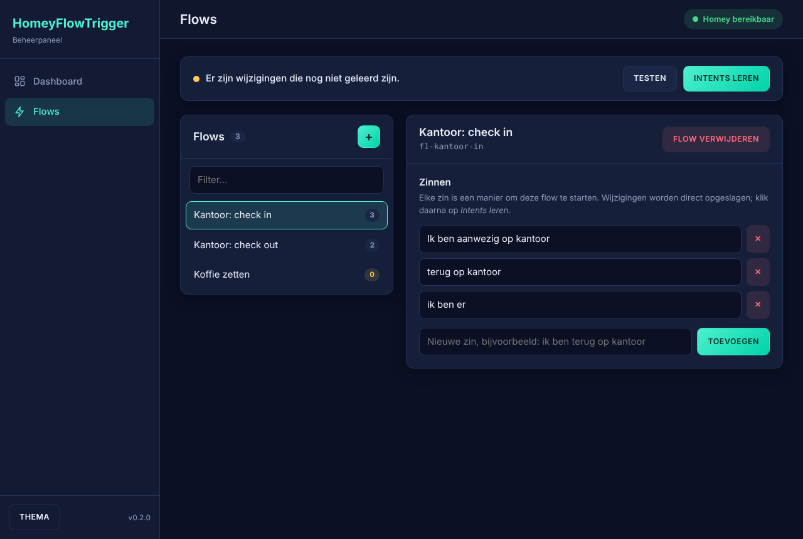
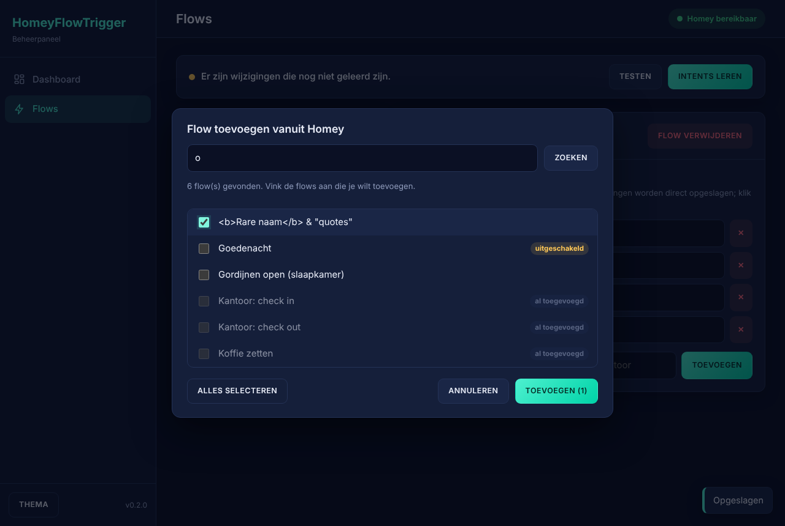
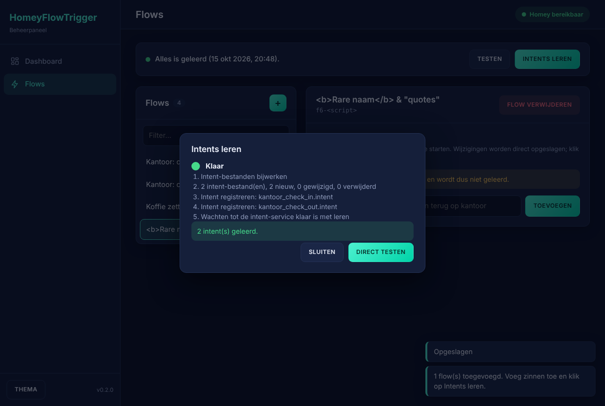
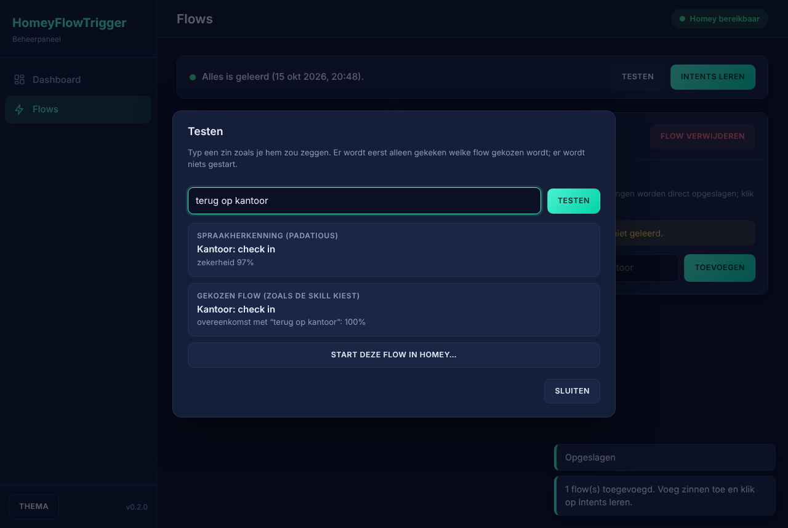
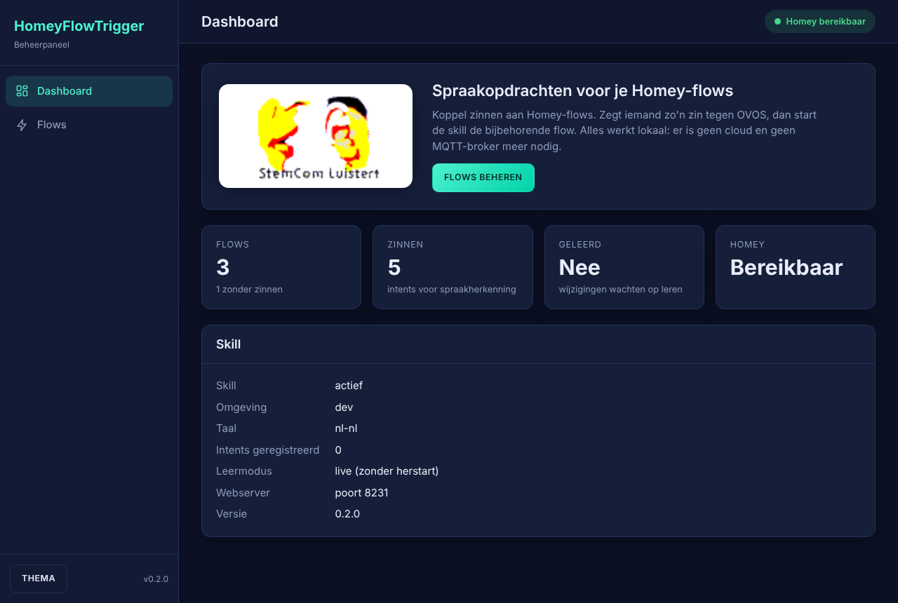
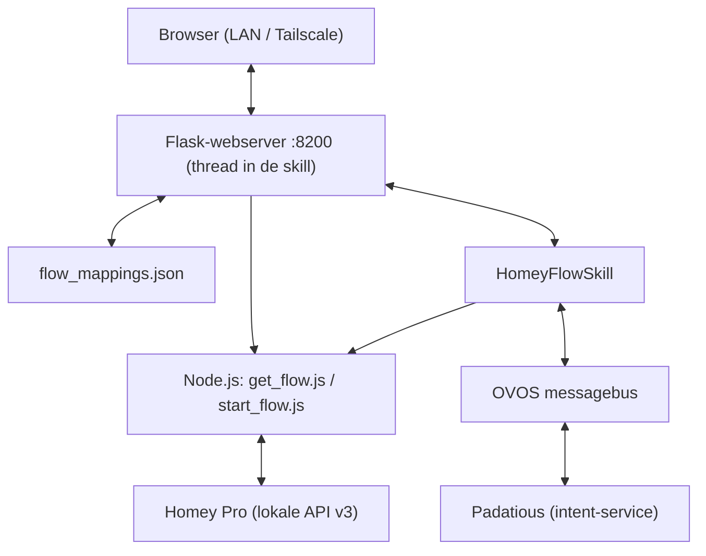

# ovos-skill-homeyflowtrigger-web

OVOS-skill die **Homey-flows start met een spraakopdracht**. Dit is de variant met een **ingebouwde
beheerwebserver**: de MQTT-broker is vervangen door een lokale webpagina (Flask) in dezelfde container
als de skill. Zo pas je zinnen en flows aan vanaf je LAN of via Tailscale, zonder cloud, zonder
inloggegevens in de code en zonder claimen van een apparaatnaam.

De werking van de skill zelf is gelijk gebleven aan [ovos-skill-homeyflowtrigger]: een zin wordt via
fuzzy matching (`difflib`, drempel 0,6) aan een flow gekoppeld en met `start_flow.js` (homey-api v3)
gestart.



## Functies

- **Spraak → flow:** per flow een `.intent`-bestand voor Padatious; de skill kiest de beste zin en start de flow.
- **Webpagina op poort 8200** (geen wachtwoord, zie [Beveiliging](#beveiliging)):
  - *Dashboard* met logo, aantallen, status van Homey en van het leren.
  - *Flows*: links alle flows uit `flow_mappings.json`, rechts de zinnen van de gekozen flow
    (toevoegen, wijzigen, verwijderen; wijzigingen worden direct opgeslagen).
  - **+** bovenaan de lijst: flows uit Homey zoeken op zoekterm (via `get_flow.js`) en er meerdere tegelijk toevoegen.
  - **Intents leren:** met bevestiging; de skill registreert de zinnen opnieuw bij de intent-service.
  - **Meldingen:** de gesproken antwoorden aanpassen en beluisteren (zie [Meldingen](#meldingen)).
  - **Testen:** zin intypen en zien welke flow gekozen wordt (zowel door Padatious als door de skill).
    Een flow écht starten kan pas na een tweede bevestiging.
  - Donker en licht thema, werkt ook op een telefoon.
- Onbekende velden in `flow_mappings.json` (zoals `favorite_flow`) blijven behouden.
- De laatste 10 versies van `flow_mappings.json` worden bewaard in `flow_mappings_backups/`.
- Beide varianten blijven bestaan: `__init__.py` (systemd) en `__init__container.py` (container).

| | |
|---|---|
|  |  |
|  |  |

## Hoe het werkt



De webserver draait als thread in het skill-proces (`waitress`) en wordt als **eerste** gestart in
`initialize()`. De pagina blijft dus bereikbaar en toont een foutmelding als de rest van de skill niet
start. Bij een herlaadbeurt van de skill wacht de server tot de poort weer vrij is.

### Leren

Een nieuwe of gewijzigde zin werkt pas voor spraak nadat Padatious hem geleerd heeft. De knop
**Intents leren** doet dat zonder de container te herstarten:

1. de `.intent`-bestanden worden bijgewerkt (flows zonder zinnen krijgen geen bestand);
2. alle intents van de skill worden bij de intent-service losgekoppeld en wachten op bevestiging
   (`intent.service.padatious.manifest.get`);
3. ze worden opnieuw geregistreerd; Padatious traint zelf (`mycroft.skills.trained`);
4. de pagina toont het resultaat en onthoudt wat geleerd is (`training_state.json`). Staat er een
   wijziging in die nog niet geleerd is, dan zie je dat bovenaan de flowpagina.

Lukt dat bij jouw OVOS-versie niet, zet dan `"training": {"mode": "restart"}` in `config.json`
(of `HOMEYFLOW_TRAINING_MODE=restart`). De skill stopt dan zichzelf en Docker start de container
opnieuw (`restart: unless-stopped`); in de systemd-variant wordt `ovos.service` herstart.
Er is **geen Docker-socket** nodig.

## Meldingen

Na het starten van een flow zegt de assistent standaard alleen een korte bevestiging (**"Gedaan."**).
Op de pagina **Meldingen** pas je dit en de andere gesproken antwoorden aan:

- *Flow gestart*, *Zin niet herkend*, *Flow zonder id*, *Starten mislukt* en *Instellingen onleesbaar*.
- Invulvelden: `{flow}` (naam van de flow) en `{utterance}` (wat je zei); per melding staat erbij welke kunnen.
- Laat *Flow gestart* leeg om na het starten niets te zeggen.
- **Afspelen** laat de assistent de tekst direct uitspreken (met voorbeeldwaarden), nog voor je opslaat.
- Wijzigingen gelden direct na opslaan; leren of herstarten is niet nodig.

De teksten staan in `spoken_messages.json` naast `flow_mappings.json` (alleen wat je aanpast). Verwijder het
bestand om alles terug te zetten naar de standaardteksten.

## Installatie (Docker)

1. Maak de map voor je gegevens en zet je Homey-gegevens in `config/config.json`
   (voorbeeld: `config.example.json`). Een API-key maak je in Homey onder *Instellingen → API-sleutels*.

   ```json
   {
     "homey": { "address": "http://192.168.1.50", "token": "<API-key>" },
     "web": { "host": "0.0.0.0", "port": 8200, "allowed_hosts": [] },
     "language": "nl-nl",
     "training": { "mode": "live", "timeout": 120 }
   }
   ```

   Adres en token kunnen ook via `HOMEYFLOW_HOMEY_ADDRESS` en `HOMEYFLOW_HOMEY_TOKEN`.
   `language` moet overeenkomen met de taal waarin OVOS luistert (standaard `nl-nl`).

2. Kopieer `.env.example` naar `.env` en vul het Docker-netwerk en de OVOS-config in.
   Het voorbeeld in `docker-compose.yml` gaat uit van een extern netwerk (`OVOS_NETWORK`) en dezelfde
   OVOS-configmap als je andere OVOS-containers (`OVOS_CONFIG_FOLDER`), zodat de skill de messagebus
   vindt. **Pas dit aan op je eigen stack** of voeg de service toe aan je bestaande compose-bestand.

3. Bouwen en starten:

   ```bash
   docker compose up -d --build
   docker compose logs -f homeyflowtrigger
   ```

4. Open `http://<host>:8200` (of het Tailscale-adres/-MagicDNS-naam van de host).

Het dockerfile kopieert `__init__container.py` over `__init__.py` en start
`ovos-skill-launcher ovos-skill-homeyflowtrigger-web.stemcom`. De Node.js-module `homey-api` wordt
tijdens het bouwen geïnstalleerd, niet bij elke start.

### Zonder Docker (systemd)

```bash
pip install -e .
(cd nodejs && npm install --omit=dev)
```

Zet `config.json` in `~/.config/ovos_skill_homeyflowtrigger/` en herstart `ovos.service`.

### Overstappen vanaf de originele skill

- De map `~/.config/ovos_skill_homeyflowtrigger/` met `config.json` en `flow_mappings.json` wordt
  hergebruikt. De secties `broker`, `device` en `topics` worden genegeerd.
- **Zet de oude skill uit** voordat je deze start. Beide skills zouden dezelfde zinnen registreren en
  allebei antwoorden.
- Bestaande flows krijgen bij het eerst opslaan geen nieuwe velden; nieuw toegevoegde flows krijgen een
  `title` (de leesbare Homey-naam, ook gebruikt in de gesproken bevestiging).
- Trek het HiveMQ-wachtwoord uit de oude repo in; dat staat daar in de geschiedenis.

## Beveiliging

De pagina heeft **geen wachtwoord**; wie het lokale netwerk of je tailnet op komt, kan de zinnen aanpassen
en flows starten. Daarom:

- Forward de poort **niet** op je router. Docker omzeilt vaak `ufw`; publiceer de poort liever op een
  specifiek adres (`HOMEYFLOW_BIND=100.x.y.z`).
- De server weigert verzoeken met een onbekende hostnaam (tegen DNS-rebinding). Toegestaan zijn IP-adressen,
  `localhost`, namen zonder punt en `*.local`, `*.lan`, `*.home.arpa`, `*.internal`, `*.ts.net`.
  Gebruik je een eigen domeinnaam, zet die dan in `web.allowed_hosts`.
- Wijzigende verzoeken moeten `application/json` zijn en van dezelfde herkomst komen. Een andere website
  in je browser kan dus geen zinnen wijzigen of flows starten.
- Het Homey-token wordt nooit naar de browser gestuurd en komt niet in foutmeldingen.
- Pagina's mogen niet in een frame (`X-Frame-Options: DENY`) en laden geen externe scripts of lettertypen.

## API

| Methode | Pad | |
|---|---|---|
| GET | `/healthz` | gezondheid |
| GET | `/api/status` | Homey, aantallen, leerstatus, skill |
| GET | `/api/flows` | alle flows met zinnen |
| POST | `/api/flows` | flows toevoegen `{"flows":[{"id","name"}]}` |
| PUT | `/api/flows/<sleutel>` | zinnen vervangen `{"sentences":[...]}` |
| DELETE | `/api/flows/<sleutel>` | flow verwijderen |
| GET | `/api/homey/flows?q=` | flows uit Homey zoeken |
| GET / POST | `/api/learn` | status / leren starten `{"confirm":true}` |
| POST | `/api/test` | `{"utterance"}`; met `"run":true,"confirm":true` start hij de flow echt |
| POST | `/api/restart` | skill herstarten `{"confirm":true}` |

## Ontwikkelen en testen

```bash
python dev/run_dev.py            # pagina met nep-Homey en nepskill op http://127.0.0.1:8200
python -m pytest tests           # unit- en webtests
```

`tests/test_skill_integration.py` draait de echte skill-klasse tegen een nagebootste intent-service
en wordt overgeslagen zonder `ovos-workshop`.

## Bekende beperkingen

- Alleen gewone Homey-flows (zoals de originele skill), geen Advanced Flows.
- De skill kiest de flow met fuzzy matching op de uitspraak, niet op de naam van de herkende intent.
  De testpagina toont beide en waarschuwt als ze verschillen.
- Het logo is klein (128×64) en wordt op het dashboard vergroot weergegeven.

[ovos-skill-homeyflowtrigger]: https://github.com/stemcom/voice-assistant-homeyflowtrigger
